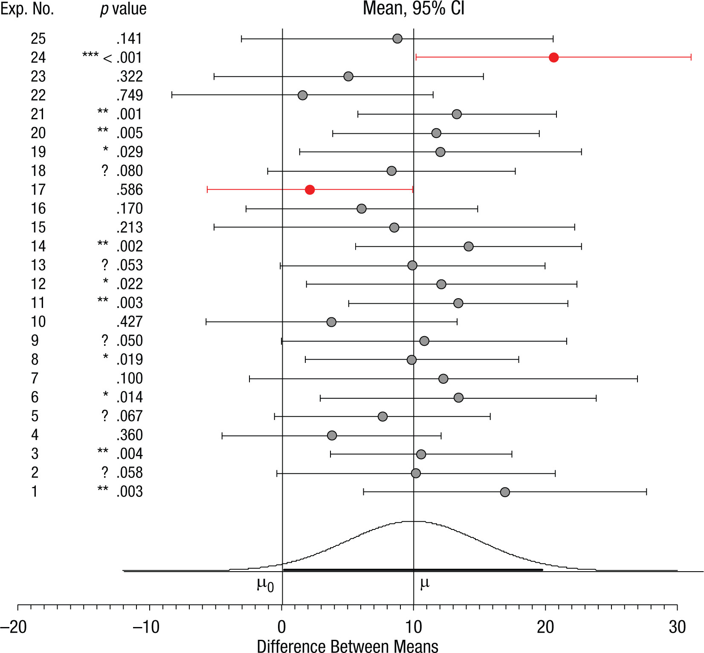
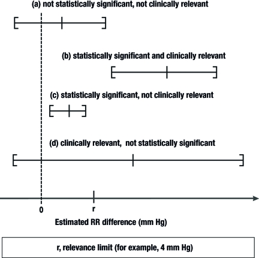

---
format:
  revealjs:
    css: "include/style.css"
    chalkboard: true
    multiplex: true
    slide-number: c/t
    drop:
      shortcut: "]"
      engine: webr
      webr:
        packages:
          - tidyverse
revealjs-plugins:
  - drop
width: 1920
height: 1080
title: "Intro to Power and Effect Sizes in Clinical Psychology Research"
subtitle: DClin Research Methods 1
author: Dr Christopher Wilson
institute: Teesside University
logo: "logo.jpg"
csl: apa.csl
bibliography: references.bib
---

## Learning outcomes

- Understand the Neyman-Pearson decision framework: Type I ($\alpha$) and Type II ($\beta$) errors
- Understand the sampling distribution under the null hypothesis and what $p$-values represent
- Distinguish between statistical significance and clinical importance
- Understand effect sizes in both unstandardized (clinical scale units) and standardized metrics
- Understand statistical power ($1 - \beta$) and how it relates to sample size ($N$), effect size, and $\alpha$
- Understand the risks of underpowered studies: Type M (magnitude) and Type S (sign) errors

## Recall from last week

- One of the common issues with clinical research is that studies are underpowered.

- When studies lack statistical power, non-significant findings are uninformative, and significant findings are often exaggerated.

- Today we examine how statistical significance, effect size, sample size, and statistical power interrelate when designing clinical research.

# Part 1: The Decision Framework and the Null Hypothesis

## What is the null hypothesis?

- The null hypothesis ($H_0$) posited in clinical trials typically asserts that there is no true difference between treatment arms, or no association between variables in the target population.

- For example, if comparing an intervention group to a treatment-as-usual (TAU) control on depression scores:

  - $H_0: \mu_{\text{Intervention}} - \mu_{\text{TAU}} = 0$
  - $H_1: \mu_{\text{Intervention}} - \mu_{\text{TAU}} \neq 0$

- Statistical hypothesis testing does not evaluate whether our hypothesis is "proven"; it evaluates how compatible the observed sample data are with $H_0$.

## The $2 \times 2$ Decision Matrix

When using sample data to make a categorical decision about a population parameter, four outcomes are possible:

|   | True State: $H_0$ is True (No Effect) | True State: $H_1$ is True (Real Effect Exists) |
|:--------------------|:------------------------:|:------------------------:|
| **Decision: Reject** $H_0$ ("Statistically Significant") | **Type I Error (**$\alpha$)<br>False Positive Rate (e.g., .05) | **Correct Decision (**$1 - \beta$)<br>Statistical Power (e.g., .80) |
| **Decision: Fail to Reject** $H_0$ ("Not Significant") | **Correct Decision (**$1 - \alpha$)<br>Specificity (e.g., .95) | **Type II Error (**$\beta$)<br>False Negative Rate (e.g., .20) |

- **Type I error (**$\alpha$): Declaring an ineffective treatment effective.
- **Type II error (**$\beta$): Missing a genuine clinical treatment effect.

## What is statistical significance?

- **The** $p$-value is the continuous probability of obtaining sample data at least as extreme as the observed result, assuming the null hypothesis is true: $$p = P(D \ge d_{\text{obs}} \mid H_0)$$
  - It does **not** indicate the probability that $H_0$ is true ($P(H_0 \mid D)$).
  - It does **not** reflect the clinical magnitude or practical utility of the treatment.
- **Statistical Significance** is a decision rule applied when the calculated $p$-value falls at or below a predetermined threshold ($\alpha$):
  - If $p \le \alpha$, we reject $H_0$.
  - The threshold $\alpha = .05$ is a historical convention, representing a tolerated 5% long-run Type I error rate when $H_0$ is true [@wassersteinASAStatementPValues2016].

# Part 2: Sampling Variability Under the Null ($H_0$ is True)

## A Clinical Simulation: Zero Population Difference

Suppose an entire clinical population consists of 2,000 patients with generalized anxiety disorder: - 1,000 receive an active psychological therapy. - 1,000 receive treatment as usual (TAU). - **The Ground Truth:** The treatment has zero effect ($\mu_1 = \mu_2 = 0, \sigma_1 = \sigma_2 = 1$). The null hypothesis is strictly true.

```{r, echo=FALSE, message=FALSE, warning=FALSE, fig.width=7, fig.height=3.5, fig.align='center'}
library(ggplot2)

set.seed(1232)
n_pop <- 1000
pop_treatment <- rnorm(n_pop, mean = 0, sd = 1)
pop_control <- rnorm(n_pop, mean = 0, sd = 1)

pop_data <- data.frame(
  group = factor(rep(c("Control", "Treatment"), each = n_pop)),
  value = c(pop_control, pop_treatment)
)

ggplot(pop_data, aes(x = group, y = value, colour = group)) +
  geom_jitter(width = 0.2, alpha = 0.4, size = 1) +
  theme_classic() +
  theme(legend.position = "none") +
  labs(x = "Clinical Group", y = "Score on Outcome Measure",
       title = "Entire Population (N = 2,000, True Difference = 0)")
```

## Running 100 Small Clinical Trials ($N = 20$ per group)

Now imagine 100 independent research teams draw a random sample of $n = 20$ per arm from this identical population.

```{r, echo=FALSE, message=FALSE, warning=FALSE, fig.width=7, fig.height=3.5, fig.align='center'}
n_studies <- 100
n_sample <- 20

sim_diffs <- numeric(n_studies)
sim_pvals <- numeric(n_studies)

set.seed(1232)
for (i in 1:n_studies) {
  s_trt <- sample(pop_treatment, size = n_sample)
  s_ctrl <- sample(pop_control, size = n_sample)
  tt <- t.test(s_trt, s_ctrl, var.equal = TRUE)
  sim_diffs[i] <- mean(s_trt) - mean(s_ctrl)
  sim_pvals[i] <- tt$p.value
}

sim_df <- data.frame(study = 1:n_studies, diff = sim_diffs, p_val = sim_pvals)

ggplot(sim_df, aes(x = diff)) +
  geom_histogram(binwidth = 0.15, fill = "#2c3e50", color = "white") +
  geom_vline(aes(xintercept = 0), color = "red", linetype = "dashed", size = 1) +
  theme_classic() +
  labs(x = "Observed Mean Difference in Sample", y = "Number of Studies",
       title = "Sampling Distribution of Mean Differences Across 100 Studies",
       subtitle = "True population difference is 0; variation is driven entirely by sampling error")
```

Even with an identical population, sampling noise produces observed group differences ranging from negative to positive.

## Observed $p$-values Across the 100 Studies

What happens when each of the 100 studies runs an independent-samples $t$-test?

```{r, echo=FALSE, message=FALSE, warning=FALSE, fig.width=8, fig.height=3.8, fig.align='center'}
sim_df$sig <- ifelse(sim_df$p_val <= 0.05, "p <= .05 (False Positive)", "p > .05")

ggplot(sim_df, aes(x = study, y = p_val, color = sig)) +
  geom_point(size = 2) +
  geom_hline(yintercept = 0.05, color = "red", linetype = "dashed") +
  scale_color_manual(values = c("p <= .05 (False Positive)" = "#e74c3c", "p > .05" = "#34495e")) +
  theme_classic() +
  theme(legend.position = "bottom", legend.title = element_blank()) +
  labs(x = "Study Number (1 to 100)", y = "Observed p-value",
       title = "Distribution of p-values Under a True Null Hypothesis",
       subtitle = "Under H0, p-values follow a uniform distribution; ~5% fall below .05 purely by chance")
```

- In this simulation, roughly 5 out of 100 studies yield $p \le .05$.
- These researchers would claim a "statistically significant" treatment effect despite the true effect being zero.

## Understanding the Sampling Distribution Under $H_0$

```{r, echo=FALSE, message=FALSE, warning=FALSE, fig.width=8, fig.height=4, fig.align='center'}
x <- seq(-4, 4, length = 300)
y <- dt(x, df = 38)

plot(x, y, type = "l", lwd = 2, xlab = "Test Statistic (t-value, df = 38)", ylab = "Density",
     main = "Theoretical t-Distribution Under H0")
abline(v = c(-2.024, 2.024), lty = 2, col = "red")
text(-2.7, 0.05, "2.5%\n(t < -2.024)", cex = 0.85, col = "red")
text(2.7, 0.05, "2.5%\n(t > 2.024)", cex = 0.85, col = "red")
text(0, 0.15, "95% of studies under H0\nfall between -2.024 and +2.024", cex = 0.9)
```

- For small samples ($n = 20$ per group, $df = 38$), sampling variability is governed by the $t$-distribution, not the standard normal distribution.
- The critical value for $\alpha = .05$ is $t = \pm 2.024$ (not $z = \pm 1.96$).
- Differences are measured in **standard errors of the difference**, not population standard deviations.

## What Small Samples Do and Do Not Do to Type I Error

- **What small samples do NOT do:**
  - Small samples do **not** increase the nominal Type I error rate ($\alpha$).
  - If $\alpha = .05$ and test assumptions hold, the false positive rate remains exactly 5%, regardless of whether $N = 20$ or $N = 20,000$.
- **What small samples DO do:**
  - **Increase estimation imprecision:** Wide standard errors mean point estimates fluctuate wildly around the truth.
  - **Produce severe power deficits:** True effects are routinely missed.
  - **Distort the published literature:** When coupled with publication bias, small significant studies yield heavily inflated effect size estimates.

# Part 3: The Flaws of NHST and the Role of Confidence Intervals

## The Problem with Threshold-Based Inference

> "It's science's dirtiest secret: The 'scientific method' of testing hypotheses by statistical analysis stands on a flimsy foundation."
>
> — George Cobb, Professor Emeritus of Mathematics and Statistics, Mount Holyoke College

- Q: Why do so many training programs teach $p \le .05$?
  - A: Because that is what journals and reviewers have historically required.
- Q: Why do researchers continue to rely on $p \le .05$?
  - A: Because that is what they were taught in graduate research methods [@wassersteinASAStatementPValues2016].

## What is the Problem with $p$-values?

> "Researchers commonly use $p$-values to answer the question: How strongly does the evidence favor the alternative hypothesis relative to the null hypothesis? $p$-Values themselves do not directly answer this question and are often misinterpreted."
>
> — @benjaminThreeRecommendationsImproving2019

- A $p$-value near $.05$ provides only weak evidence against the null hypothesis.
- A non-significant $p$-value ($p > .05$) does not demonstrate the absence of an effect; it merely indicates that the data are not sufficiently incompatible with $H_0$ under the chosen sample size.

## The ASA Statement on $p$-values

1.  $p$-values can indicate how incompatible the data are with a specified statistical model.
2.  $p$-values do not measure the probability that the studied hypothesis is true, or the probability that the data were produced by random chance alone.
3.  Scientific conclusions and clinical decisions should not be based solely on whether a $p$-value passes an arbitrary threshold.
4.  Proper inference requires full reporting and transparency (no selective reporting or $p$-hacking).
5.  A $p$-value does not measure the size of an effect or the clinical importance of a result.
6.  By itself, a $p$-value does not provide a good measure of evidence regarding a model or hypothesis [@wassersteinASAStatementPValues2016].

## $p$-values are Instable Across Replications



## Using Confidence Intervals to Interpret Results

- A **confidence interval (CI)** reflects the precision of a sample estimate.
- **Formal definition:** If we repeated our sampling procedure an infinite number of times under identical conditions, 95% of computed 95% confidence intervals would encompass the true population parameter.
- **Informal interpretation:** The 95% CI demarcates the range of parameter values that remain statistically compatible with our sample data at $\alpha = .05$.
- Unlike $p$-values, confidence intervals keep the analysis anchored to the original measurement scale.

## What Can Confidence Intervals Tell Us?

{fig-align="center"}

- Narrow CIs indicate high precision (large samples); wide CIs indicate substantial uncertainty (small samples).
- CIs allow researchers to assess whether an effect is statistically significant, clinically trivial, or practically meaningful.

## Reporting Confidence Intervals in APA Style

Always report the point estimate, the confidence level, and both bounds alongside exact $p$-values:

> "Patients receiving CBT exhibited significantly greater reductions in depressive symptoms than those in the control condition, $t(38) = 2.43$, $p = .020$, mean difference $= 4.20$ points, 95% CI $[0.70, 7.70]$, Cohen's $d = 0.77$."

- This communicates both the central estimate and the bound of uncertainty: the true average reduction could plausibly be as small as 0.70 points or as large as 7.70 points.

# Part 4: Effect Sizes and Clinical Importance

## Statistical Significance Does Not Mean Clinical Importance

- Statistical significance is highly dependent on sample size:
  - In a massive sample ($N = 10,000$), a clinically meaningless change of 0.2 points on the PHQ-9 will produce $p < .001$.
  - In a small sample ($N = 15$), a clinically transformative reduction of 6 points might yield $p = .12$.
- Clinical psychology requires measuring **magnitude of change**, not merely whether an effect is distinguishable from zero.

## What is an Effect Size?

An **effect size** is a quantitative index of the magnitude of a difference, relationship, or treatment outcome.

1.  **Unstandardized Effect Sizes:**
    - Expressed in the original clinical units of measurement (e.g., points on the Beck Depression Inventory, Hamilton Rating Scale, or minutes of sleep).
    - Readily interpretable by clinicians and service users.
2.  **Standardized Effect Sizes:**
    - Expressed without measurement units, scaling the difference by sample or pooled standard deviation (e.g., Cohen's $d$, Hedges' $g$, Pearson's $r$, Odds Ratios).
    - Essential when synthesizing across different clinical measures in meta-analyses.

## Commonly Used Standardized Effect Sizes

| Metric | Formula / Description | Common Application |
|:-----------------------|:-----------------------|:-----------------------|
| **Cohen's** $d$ | $d = \frac{\bar{X}_1 - \bar{X}_2}{s_{\text{pooled}}}$ | Mean differences between two clinical groups |
| **Hedges'** $g$ | Cohen's $d \times \left(1 - \frac{3}{4(n_1+n_2) - 9}\right)$ | Corrects for small-sample upward bias in Cohen's $d$ |
| **Pearson's** $r$ | Standardized covariance between continuous variables | Association between psychometric measures |
| **Odds Ratio (OR)** | $\frac{\text{Odds of outcome in Treatment}}{\text{Odds of outcome in Control}}$ | Binary clinical outcomes (e.g., recovery vs. relapse) |
| **Partial** $\eta^2$ | Proportion of variance explained by a factor | Factorial ANOVA in multi-arm trials |

## The Problem with Benchmark Rules of Thumb

- Jacob Cohen suggested generic benchmarks: small ($d = 0.2$), medium ($d = 0.5$), and large ($d = 0.8$).
- In clinical psychology, generic labels can be misleading:
  - An effect of $d = 0.20$ on suicide prevention or all-cause mortality is clinically vital.
  - An effect of $d = 0.80$ on a self-report proxy measure with high measurement error may have negligible clinical utility.
- Effect sizes must be interpreted relative to:
  - The specific clinical population and baseline severity.
  - The **Minimal Clinically Important Difference (MCID)**.
  - The **Reliable Change Index (RCI)**.

## Do Not Use Pilot Data to Estimate Effect Size

- Clinical researchers often compute $d$ from an underpowered pilot study ($n = 10$ per arm) and plug that estimate into G\*Power to plan a definitive trial.
- **Why this fails \[**@albersWhenPowerAnalyses2018\]**:**
  - Small sample effect sizes have extreme variance; a sample $d = 0.60$ from $N = 20$ may easily reflect a population effect of $d = 0.15$.
  - "Follow-up bias": Researchers only proceed to a full trial when the pilot effect happens to land high.
- **Better alternatives:**
  - Define the **Smallest Effect Size of Interest (SESOI)** based on clinical cost-benefit and patient impact [@lakensPerformingHighpoweredStudies2014].
  - Use safeguard power analysis (taking the lower bound of the CI from prior literature) [@peruginiSafeguardPowerProtection2014].

# Part 5: Statistical Power and Sample Planning ($H_1$ is True)

## What is Statistical Power?

- **Statistical Power (**$1 - \beta$) is the probability of correctly rejecting the null hypothesis when a specific alternative hypothesis ($H_1$) is true.
- If an intervention genuinely reduces symptoms by $d = 0.50$, an 80% powered study will successfully detect that effect ($p \le .05$) 80 times out of 100.
- 20 times out of 100, the study will commit a **Type II error (**$\beta = .20$)—failing to detect a genuinely effective treatment.

## The Magnification Analogy

{fig-align="center"}

- **Effect Size:** The size of the object you are searching for.
- **Sample Size (**$N$): The magnification strength of your lens.
- A large effect (an elephant) can be seen with low magnification (small $N$).
- A subtle effect (a microbe) requires a powerful microscope (large $N$).

## The Four Interconnected Parameters

Any statistical test involves four mutually dependent parameters:

$$\text{Alpha } (\alpha) \quad \longleftrightarrow \quad \text{Sample Size } (N) \quad \longleftrightarrow \quad \text{Effect Size } (\delta) \quad \longleftrightarrow \quad \text{Power } (1 - \beta)$$

- If any three are specified, the fourth is mathematically fixed:
  - Given $\alpha = .05$, targeted $d = 0.50$, and power $= .80$, required $N$ is fixed.
  - Given $\alpha = .05$, available $N = 30$, and targeted $d = 0.30$, power is fixed.
- **A-priori power analysis:** Determining the required sample size *before* data collection begins.
- **Post-hoc power ("observed power"):** Calculating power based on the observed $p$-value after data collection. This provides no new information and is circular; do not use it.

## The Consequences of Underpowered Clinical Research

When studies run with low power (e.g., $1 - \beta = .30$):

1.  **High False Negative Rate:** Genuinely beneficial treatments are discarded because trials lack power to detect them.
2.  **Type M Error (Magnitude / Exaggeration):**
    - In an underpowered study, an effect can only cross the $p \le .05$ threshold if the observed sample effect is much larger than the true population effect.
    - This leads to the **Winner's Curse**: published findings systematically overestimate true treatment efficacy .
3.  **Type S Error (Sign):**
    - The probability that an observed statistically significant effect is in the opposite direction of the true effect.
4.  **Research Ethics:**
    - Exposing patients to trial burdens, risk, and clinical procedures in an underpowered study that cannot answer the scientific question is ethically indefensible.

## Visualizing Statistical Power

##  {background-iframe="https://christopherjwilson.shinyapps.io/app1/" background-interactive="true"}

# Part 6: Synthesis and Alternatives

## Takeaways for Clinical Researchers

- The $p$-value measures compatibility with $H_0$; it does not prove an effect or evaluate clinical importance.
- Type I error ($\alpha$) is fixed by the researcher; small samples do not inflate $\alpha$, but they cause catastrophic loss of power and severe estimation instability.
- Never use raw pilot effect sizes to justify sample sizes for clinical trials.
- Anchor prospective power calculations to the **Smallest Effect Size of Interest (SESOI)** or the **Minimal Clinically Important Difference (MCID)**.
- Emphasize estimation: report unstandardized mean differences and 95% confidence intervals alongside standardized effect sizes.

## Alternatives to Binary NHST

- **Estimation Statistics:** Focusing on effect sizes and confidence intervals rather than dichotomous $p$-value cutoffs.
- **Equivalence Testing (TOST):** Two One-Sided Tests designed to test for the *absence* of a meaningful effect within predefined equivalence bounds ($-\Delta$ to $+\Delta$).
- **Bayesian Parameter Estimation:** Updating prior probability distributions to generate posterior credible intervals—allowing direct statements about parameter probabilities: $$P(\theta \mid D) \propto P(D \mid \theta) P(\theta)$$
- **E-values & Evidence Ratios:** Quantifying the strength of evidence for one model relative to another rather than relying on arbitrary alpha cutoffs.

## When planning your study you should:

- Identify what is a meaningful effect for your research
- Conduct an apriori power analysis
- Plan the study based on the required sample size

# References
